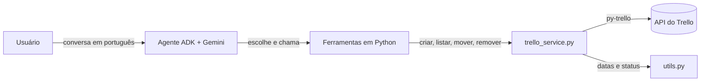
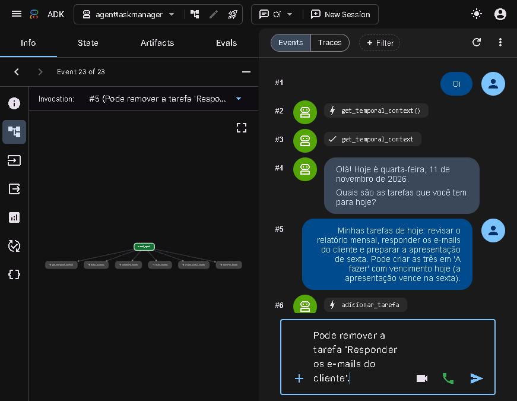
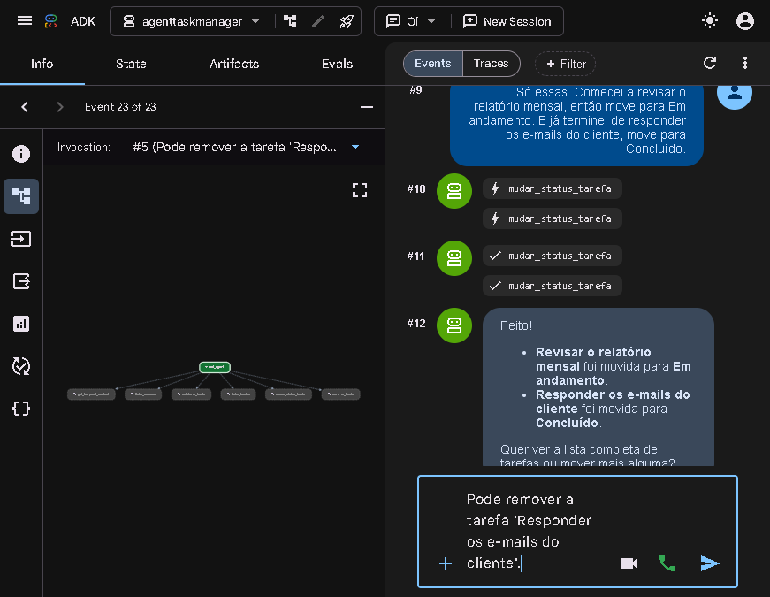
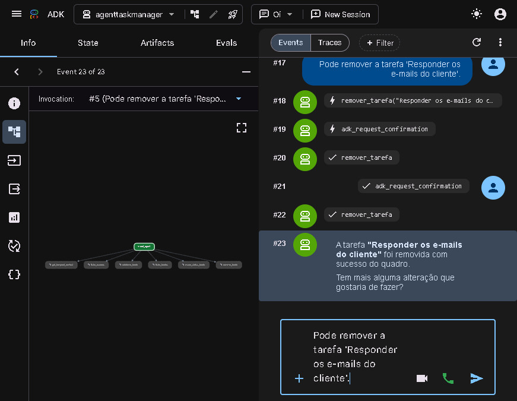
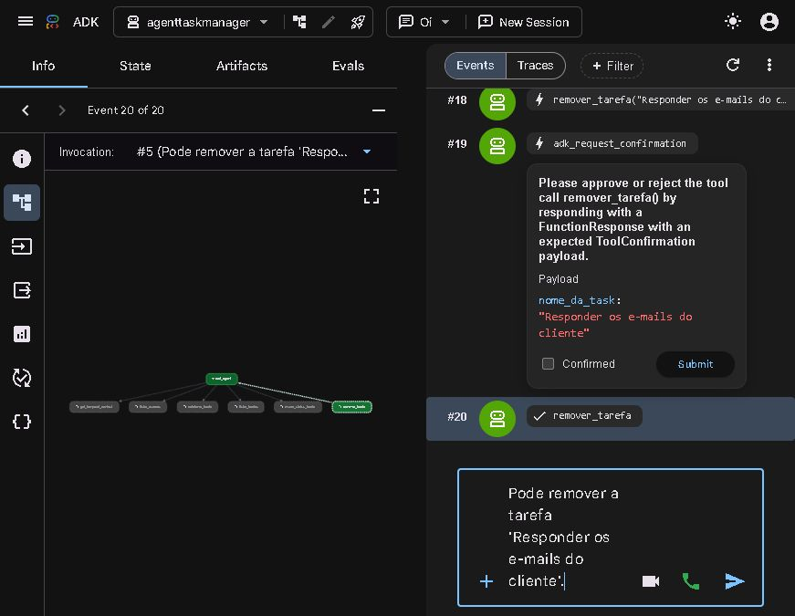
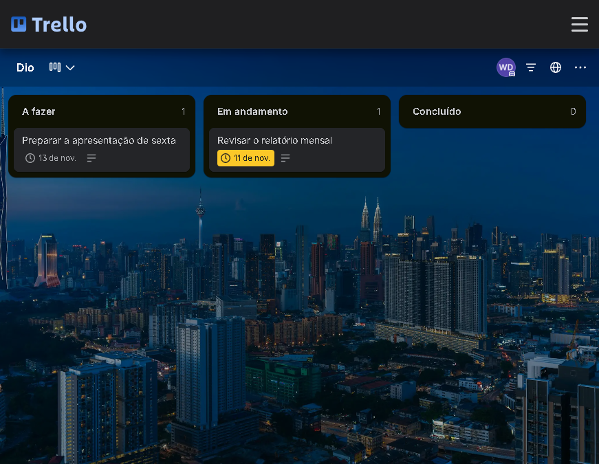

# Agente de Tarefas no Trello com Google ADK

[](https://github.com/Subaruberu/app-no-trello-com-python/actions/workflows/tests.yml)

Um agente de IA que conversa em português, organiza as tarefas do dia e
trabalha de verdade em um quadro do Trello. Cada ação é uma função Python
registrada como ferramenta no **Agent Development Kit (ADK)** do Google,
usando o modelo **Gemini**.

> Projeto desenvolvido a partir do desafio da DIO (agente `agent04`), mas em
> um repositório novo: aqui está apenas o agente de tarefas, com melhorias,
> testes e documentação.

---

## O que o agente faz

- Cumprimenta o usuário com a **data de hoje** e pergunta quais são as
  tarefas do dia.
- Cria **um card por tarefa** na lista **A fazer**, com nome, descrição e
  data de vencimento.
- **Lista** todas as tarefas ou filtra por status.
- **Move** cards entre **A fazer**, **Em andamento** e **Concluído** quando
  o usuário conta o que já fez.
- **Remove** cards, somente depois de confirmação explícita.
- Funciona com **mais de um quadro**: o usuário pode escolher em qual quadro
  a tarefa entra.

### Ferramentas registradas no agente

| Ferramenta | O que faz | Exemplo de pedido |
|---|---|---|
| `get_temporal_context` | Retorna a data e a hora atuais no fuso configurado | "Que dia é hoje?" |
| `listar_quadros` | Lista os quadros disponíveis na conta | "Quais quadros eu tenho?" |
| `adicionar_tarefa` | Cria um card em **A fazer** | "Criar a tarefa Enviar relatório para amanhã" |
| `listar_tarefas` | Lista todas ou filtra por status | "O que tenho em andamento?" |
| `mudar_status_tarefa` | Move o card para outro status | "Terminei o relatório" |
| `remover_tarefa` | Apaga o card (com confirmação) | "Pode apagar a tarefa antiga" |

O agente só afirma que criou, moveu ou removeu algo **depois** de chamar a
ferramenta e receber sucesso. Se a ferramenta devolver erro, ele explica o
problema em vez de inventar um resultado.

> No `adk web`, a conversa começa quando você envia a primeira mensagem (um
> "oi" basta). Nessa resposta o agente usa `get_temporal_context`,
> cumprimenta com a data de hoje e pergunta as tarefas. O ADK não permite que
> o agente envie a primeira mensagem sozinho.

---

## Melhoria escolhida: datas certas e status sem dor de cabeça

O código base tinha dois incômodos bem visíveis no uso real. Os dois foram
corrigidos e cobertos por testes.

### 1. A data que chegava ao Trello com um dia a menos

**Problema:** o Trello guarda o vencimento em UTC. Quando a data era enviada
sem fuso (ou como meia-noite), o card aparecia no dia anterior para quem está
no horário de Brasília (UTC−3).

**Solução:** `agenttaskmanager/utils.py` agora converte a data para ISO 8601
**com o fuso local** e usa 23:59 como horário padrão:

```text
"2026-11-11"  ->  "2026-11-11T23:59:00-03:00"
```

Na volta, `formatar_data_hora` converte o valor UTC do Trello para o fuso
local antes de exibir. O fuso é configurável em `TRELLO_TIMEZONE`.

### 2. "Concluído" com acento dava status inválido

**Problema:** o mapa de status aceitava apenas `"concluido"` sem acento. Quem
digitava "concluído" recebia um erro.

**Solução:** a função `normalizar` remove acentos, ignora maiúsculas e espaços
extras. Além disso, cada status tem uma lista de apelidos:

| Status | Também aceita |
|---|---|
| A fazer | `todo`, `to do`, `backlog`, `pendente`, `a iniciar` |
| Em andamento | `doing`, `em progresso`, `fazendo`, `in progress` |
| Concluído | `concluída`, `done`, `feito`, `finalizado`, `completo` |

Assim, "Concluído", "concluida", "DONE" e "feito" chegam na mesma lista.

### Como testei

- **Testes automáticos** com um cliente falso do Trello, sem tocar no quadro
  real: criação, listagem, filtro por status, movimentação, remoção, quadro
  inexistente e listas em inglês (`To Do` / `Doing` / `Done`).
- **Teste manual executado** no `adk web` e no Trello real (checklist e
  capturas abaixo): criar cards com vencimento, conferir a data no quadro,
  mover dizendo "terminei essa tarefa" e remover com confirmação.

```bash
python -m pytest -q
# 28 passed
```

### Melhorias extras incluídas

- **Conexão centralizada:** `get_client()` cria o cliente do Trello uma única
  vez e valida as credenciais. Antes, cada ferramenta repetia a conexão.
- **`try/except` em todas as ferramentas:** erros de credencial, rede, status
  ou card inexistente voltam como mensagem amigável, sem derrubar o agente.
- **Ferramenta de remoção:** a instrução prometia remover tarefas, mas o
  código não tinha a função. Agora `remover_tarefa` existe, está alinhada à
  instrução e é registrada com `require_confirmation=True`: o ADK web mostra
  um botão de confirmação antes de apagar o card.
- **Vários quadros:** `listar_quadros` e o parâmetro opcional `quadro` em
  todas as ferramentas permitem escolher onde a tarefa entra.
- **Script de preparação:** `scripts/criar_quadro.py` cria o quadro e as três
  listas automaticamente, sem duplicar o que já existe.

---

## Estrutura do projeto

```text
.
├── agenttaskmanager/
│   ├── __init__.py
│   ├── agent.py            # agente + ferramentas (a "cara" do ADK)
│   ├── config.py           # leitura do .env e configurações
│   ├── trello_service.py   # conexão e operações no Trello
│   └── utils.py            # normalização de texto e datas
├── scripts/
│   ├── criar_quadro.py     # cria o quadro e as listas
│   ├── teste_real.py       # testa o fluxo completo no Trello, sem Gemini
│   └── verificar_conexao.py # confere .env e conexão com o Trello
├── docs/
│   ├── guia-trello.md      # passo a passo de credenciais e problemas comuns
│   └── *.png, *.jpeg       # capturas do adk web e do quadro
├── tests/
│   ├── test_agent_tools.py
│   └── test_trello_service.py
├── .env.exemplo
├── .gitignore
├── pytest.ini
├── requirements.txt
├── requirements-dev.txt
└── README.md
```

A separação é simples de propósito:

- `agent.py` só conhece o ADK e formata as respostas;
- `trello_service.py` concentra a API do Trello;
- `utils.py` tem funções puras, fáceis de testar.



---

## Como rodar

### 1. Pré-requisitos

- **Python 3.10 ou superior** (o ADK atual exige isso; o guia antigo do
  repositório base falava em 3.7).
- Conta no **Trello**.
- Chave gratuita do **Google AI Studio**.

### 2. Clone o repositório e crie o ambiente virtual

```bash
git clone https://github.com/Subaruberu/app-no-trello-com-python.git
cd app-no-trello-com-python
```

Windows (PowerShell):

```powershell
python -m venv .venv
.\.venv\Scripts\Activate.ps1
pip install -r requirements.txt
```

Linux/macOS:

```bash
python3 -m venv .venv
source .venv/bin/activate
pip install -r requirements.txt
```

### 3. Prepare o quadro no Trello

Crie um quadro com estas três listas, com estes nomes:

```text
A fazer
Em andamento
Concluído
```

Ou deixe o script fazer isso por você, depois de preencher o `.env`:

```bash
python scripts/criar_quadro.py --nome "DIO"
```

O script cria o quadro se ele não existir e garante as três listas. Se o seu
quadro tiver outro nome, use `--nome` ou ajuste `TRELLO_BOARD_NAME` no `.env`.

### 4. Registre o aplicativo no Trello

1. Acesse o portal de Power-Ups: <https://trello.com/power-ups/admin/>
2. Clique em **New** e preencha nome, workspace, e-mail e autor.
3. Na página do aplicativo, copie a **API Key** e o **Secret**.
4. Gere o token abrindo a URL abaixo, trocando `SUA_API_KEY` pela sua chave:

```text
https://trello.com/1/authorize?expiration=never&name=AgenteTarefas&scope=read,write&response_type=token&key=SUA_API_KEY
```

5. Autorize o aplicativo e copie o **token** exibido.

> O passo a passo completo, com solução de problemas, está em
> [`docs/guia-trello.md`](docs/guia-trello.md).

### 5. Configure as credenciais

Copie o arquivo de exemplo e preencha:

Windows:

```powershell
Copy-Item .env.exemplo .env
```

Linux/macOS:

```bash
cp .env.exemplo .env
```

```dotenv
GOOGLE_GENAI_USE_VERTEXAI=0
GOOGLE_API_KEY=sua-chave-do-google-ai-studio
GEMINI_MODEL=gemini-2.5-flash

TRELLO_API_KEY=sua-chave
TRELLO_API_SECRET=seu-segredo
TRELLO_TOKEN=seu-token

TRELLO_BOARD_NAME=DIO
TRELLO_TIMEZONE=America/Sao_Paulo
```

O `.env` está no `.gitignore` e **não deve ser commitado**. O
`.env.exemplo` fica no repositório apenas com valores fictícios.

> **Cota do plano gratuito:** `gemini-2.5-flash` no nível gratuito tem limite
> de 5 requisições por minuto e 20 por dia. Cada mensagem da conversa gasta
> mais de uma requisição (o agente chama ferramentas em sequência), então uma
> conversa longa pode esgotar o dia. Se isso acontecer, troque
> `GEMINI_MODEL` por um modelo com cota maior, como
> `gemini-3.5-flash-lite`, e reinicie o `adk web`.

### 6. Rode o agente

Na raiz do projeto:

```bash
adk web
```

Abra <http://localhost:8000>, escolha o agente **agenttaskmanager** e
converse. Para usar no terminal, também é possível rodar:

```bash
adk run agenttaskmanager
```

---

## Exemplo de conversa

```text
Você: oi

Agente: Olá! Hoje é 2026-11-11 (quarta-feira). Quais são as tarefas do dia?

Você: preciso enviar o relatório mensal e revisar o contrato

Agente: Certo! Qual é o prazo do relatório mensal?

Você: amanhã

Agente: ✅ Tarefa criada em "A fazer": Enviar relatório mensal
        (vencimento: 12/11/2026). Tem mais alguma tarefa?

Você: revisar o contrato pode ser para hoje, e por enquanto é só

Agente: ✅ Tarefa criada em "A fazer": Revisar contrato
        (vencimento: 11/11/2026). Suas tarefas de hoje estão organizadas!

Você: comecei a revisão do contrato

Agente: ✅ "Revisar contrato": A fazer → Em andamento.

Você: terminei o relatório

Agente: ✅ "Enviar relatório mensal": A fazer → Concluído.
```

---

## Demonstração

Conversa real no `adk web` com o agente criando, movendo, listando e
removendo cards no quadro **Dio** do Trello.

**1. Saudação com a data atual** (a ferramenta `get_temporal_context` é
chamada antes de responder):



**2. Criação das três tarefas e mudança de status:**



**3. Listagem do quadro e remoção com confirmação do ADK:**



O ADK exibe um diálogo de confirmação antes de executar `remover_tarefa`
(registrada com `require_confirmation=True`):



**Resultado no Trello** depois da conversa — cada card na lista certa e com
o vencimento no dia correto:



---

## Como testar

### Testes automáticos

```bash
pip install -r requirements-dev.txt
python -m pytest -q
```

Os testes usam um **cliente falso** do Trello. Eles não precisam de chave do
Gemini, token do Trello nem internet, e não alteram o seu quadro.

### Verificação de conexão

Depois de preencher o `.env`:

```bash
python scripts/verificar_conexao.py
```

O script confere se as variáveis existem, lista os quadros visíveis e mostra
as listas do quadro padrão. Ele **não exibe** chaves nem tokens.

### Fluxo completo no Trello real (sem gastar Gemini)

```bash
python scripts/teste_real.py
```

Esse script cria um card de teste, lista, move para **Em andamento**, move
para **Concluído** e remove o card no final. É a forma mais rápida de validar
credenciais e nomes de listas sem consumir a cota diária do modelo. Ele
também tenta limpar o card se algo falhar no meio do caminho.

### Checklist manual no `adk web`

Itens executados de ponta a ponta no quadro real durante a demonstração:

- [x] O agente cumprimenta com a data de hoje.
- [x] Cria cards com nome e data de vencimento em **A fazer**.
- [x] A data no Trello é a mesma informada (sem um dia a menos).
- [x] Lista todas as tarefas do quadro.
- [x] Move um card dizendo "terminei..." e o card muda de lista.
- [x] Aceita "Concluído" com acento na conversa.
- [x] Pede confirmação antes de remover e remove o card.

Os cenários restantes são cobertos pelos testes automáticos, sem gastar cota
do Gemini nem alterar o quadro:

- [x] Filtra a listagem por "em andamento" e "concluído".
- [x] Com mais de um quadro, usa o quadro informado.
- [x] Ao simular erro (token inválido, card inexistente), responde com
  mensagem clara em vez de derrubar o agente.

> Dica: use um quadro de testes. O agente cria e apaga cards de verdade.

---

## Segurança

- `.env` está no `.gitignore`; só o `.env.exemplo` é versionado.
- Nunca cole chaves, segredos ou tokens em issues, prints ou commits.
- Se um token vazar, revogue-o no Trello e gere outro.
- O token do Trello dá acesso de leitura e escrita aos seus quadros. Use o
  escopo mínimo necessário e um quadro dedicado para testes.

---

## Créditos

- Desafio original: [DIO](https://www.dio.me/) — agente `agent04` do
  repositório [agent-carbon-footprint](https://github.com/digitalinnovationone/agent-carbon-footprint/tree/main/agents/agent04).
- Aulas e construção do agente base: Henrique Eduardo Souza.
- [Google ADK](https://google.github.io/adk-docs/) e
  [Gemini](https://ai.google.dev/).
- [py-trello](https://github.com/sarumont/py-trello).
